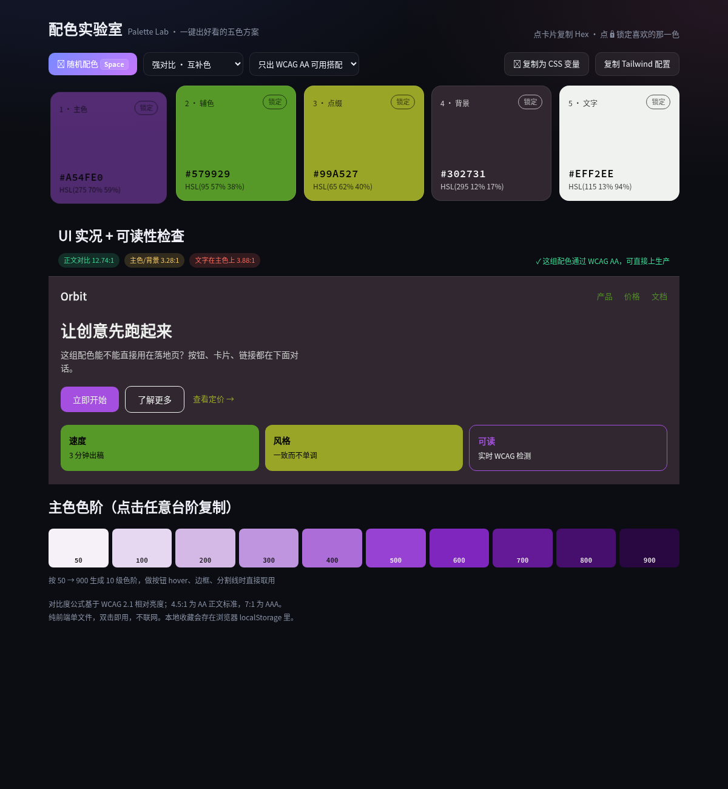

# 配色实验室 · Palette Lab（Day 02）

> 一键生成和谐的五色配色方案，带 WCAG 对比度实时检测和主色色阶，复制即可用。

## 解决什么问题

做页面 / 海报 / PPT 时最耗时的不是写代码，而是"这五个颜色配不配、文字看不看得清"。
Palette Lab 把配色这件事变成一次点击：

- **秒出色板**：邻近色 / 互补色 / 三角色 / 同色阶 / 莫兰迪 / 霓虹 六种规则
- **不瞎配**：开启「只出 WCAG AA 可用搭配」后，生成器会自动约束主色、辅色、背景、文字的对比度，保证生成的颜色**能直接用在真实界面上**
- **所见即所得**：底部是真实渲染的落地页片段（导航、标题、按钮、卡片），颜色不好看/看不清一眼就知道
- **能直接落地**：一键复制 CSS 变量、Tailwind 配置、10 级主色色阶（50→900）

## 怎么用

零依赖、零安装 —— 直接用浏览器打开 `index.html` 即可（双击文件或 `file://` 打开都行）。

| 操作 | 说明 |
|---|---|
| 点「🎲 随机配色」或按空格 | 换一组配色 |
| 点色块 | 复制该色的 Hex |
| 点色块右上角「锁定」 | 固定这一色，之后只换其它色（适合"品牌色不能动"的场景） |
| 「配色规则」下拉 | 切换色相关系与明暗基调 |
| 「只出 WCAG AA 可用搭配」 | 生成时强制满足对比度约束 |
| 「复制为 CSS 变量」/「复制 Tailwind 配置」 | 直接粘进项目 |
| 点色阶任一台阶 | 复制 `50~900` 中该级的 Hex |

## 实现要点

- 纯单文件 HTML/CSS/JS，无任何外部依赖，不联网
- HSL 变量空间生成 + 多轮采样择优：先保证「深底浅字」，再为主色/辅色搜索既贴近原色、对比度又达标的版本；仍不达标（例如互补色天生相近）就整体重抽，超过一定轮数逐步向深色区收缩以保证收敛
- WCAG 2.1 相对亮度公式计算对比度（`(L1+0.05)/(L2+0.05)`），AA 正文 4.5:1、大字 3:1、AAA 7:1
- 色阶用固定色相 + 插值饱和/亮度生成 50→900 十级，文字颜色自动取黑/白中对比更高的那个
- 最近 12 组配色存在 `localStorage`（`palette-lab-history-v1`）
- `window.__palette` 暴露了 state / generate / contrast 等，方便自动化测试

## 验证情况

用无头 Chromium（Playwright）以 7 种规则 × 2 种过滤模式各生成 20 次实测：

```
analogic    wcag  AA通过 20/20
complement  wcag  AA通过 19/20
triad       wcag  AA通过 20/20
mono        wcag  AA通过 20/20
pastel      wcag  AA通过 13/20
vivid       wcag  AA通过 9/20
random      wcag  AA通过 20/20
锁定主色保持: true   色阶台阶数: 10   swatch 数: 5   页面错误: 无
```

## 已知限制

- 「莫兰迪」「霓虹」两种风格本身就是低对比 / 高饱和，开启 AA 过滤时只能尽量贴近，不总能 100% 达标（不达标会在预览区给出 ⚠ 提示）
- 同时锁定多个高冲突颜色时，生成器无法再调整它们的对比，以用户锁定为准
- 历史记录仅有存储逻辑，尚未做界面入口（后续版本可加"历史色板"抽屉）
- 剪贴板需要 https 或 localhost；`file://` 下自动回退到 `execCommand('copy')`

## 截图


